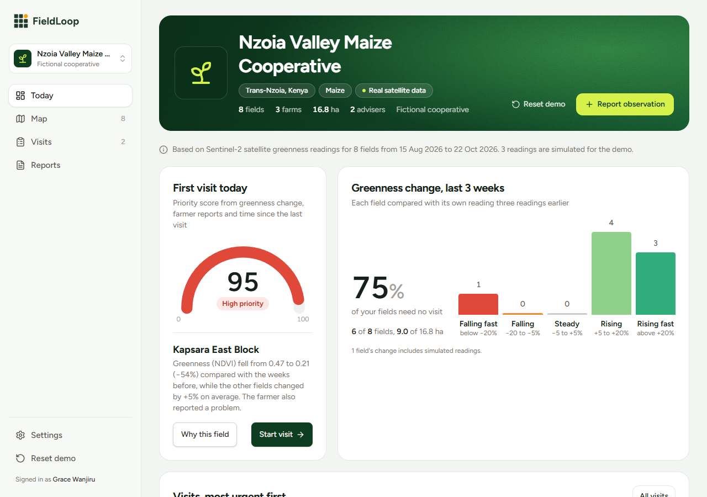
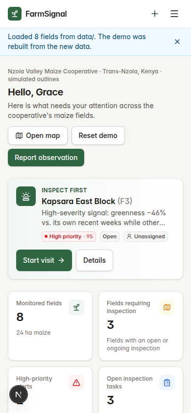
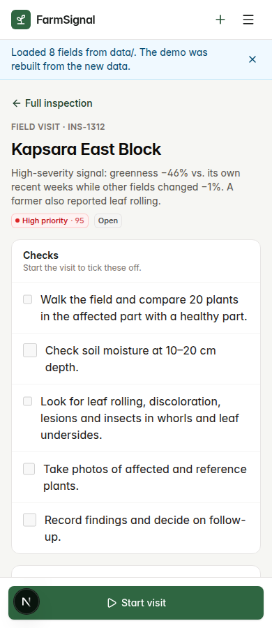
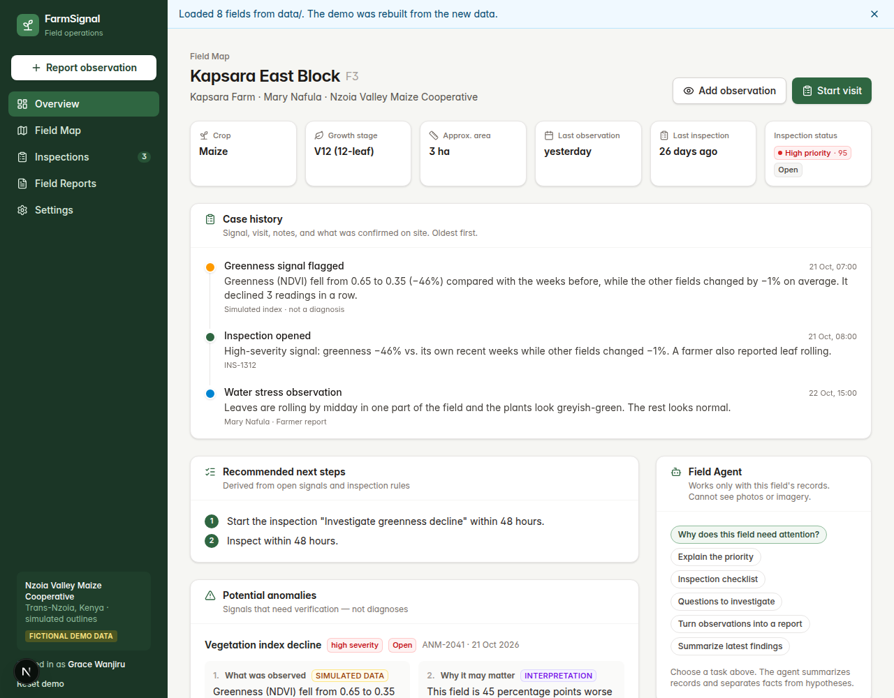

# FieldLoop

**From satellite alert to fixed field.**

FieldLoop is an AI field operations assistant for small farming cooperatives. It uses free satellite imagery and weather data to find fields that have changed, ranks them by urgency, and turns each alert into a concrete visit for a field adviser. The adviser reports back by voice note or photo, and FieldLoop tracks the case until it is resolved. Every alert ends with someone checking the plants: that is the loop in the name.

Built for the Polaris Global Hackathon (October 2026) by Dominik Knitter and Ivan Ivanovic.



## At a glance

- **Problem:** satellites can show that a field looks stressed, but a cooperative with hundreds of small plots and a few advisers still has to decide where to go first, what to look for, and make sure every alert is followed up.
- **What we built:** a working web app that runs the whole loop: change detection on real Sentinel-2 data → a ranked visit queue → a phone-first visit screen → an AI that reads the adviser's notes → a re-ranked queue and a case history per field.
- **Real data:** 8 real farm plots near Kitale, Kenya, with real Sentinel-2 greenness (NDVI) and real rainfall. One problem is planted and clearly labeled as simulated (details below).
- **Honest by design:** a low greenness reading means "something changed here, go and look", never "this is the cause". Every simulated value is labeled in the app, and the AI never claims to have looked at a photo or diagnosed a disease.

## The problem

Satellites can already tell a farmer that a field looks stressed. What they cannot do is walk to the field.

A cooperative may look after hundreds of small plots with only a few advisers. The hard part is not seeing a red patch on a map. It is deciding which field to visit first, knowing what to look for once there, and making sure every alert ends with someone actually checking the plants. Today that follow-up often lives in spreadsheets, phone calls and memory.

## What FieldLoop does

1. **Spots changes.** Compares each field's satellite crop health (NDVI) against its own history and its neighbors, and combines it with recent weather.
2. **Ranks the fields.** A transparent rule-based score produces a prioritized inspection queue: which field to visit first, why it was flagged, and how uncertain the signal is.
3. **Plans the visit.** For each flagged field it suggests what the adviser should check on site, for example signs of water stress versus pests.
4. **Closes the loop.** The adviser records notes (typed or dictated), photos and confirmed findings. FieldLoop updates the field's status, re-ranks the queue and keeps a record of what was checked and what happened.
5. **Field Agent.** An assistant embedded in each field and inspection summarizes why a field needs attention, builds checklists and questions, and turns observations into structured reports, always separating observed facts, confirmed findings and unverified hypotheses.

## Demo flow (3 minutes)

Run the app (see [Run it locally](#run-it-locally)) and open http://localhost:3000.

The app opens with **real data**: 8 real farm plots west of Kitale, Kenya, with real Sentinel-2 greenness and real rainfall. One problem is planted: the last 3 readings of **F1 (Kapsara East Block)** are lowered and labeled `simulated`, because real fields all dip together before harvest and nothing would stand out otherwise. 77 of 80 greenness readings are real. The cooperative, farmers, advisers and workflow history are fictional.

1. **Setup quiz** (under a minute, skippable): role → region (Trans-Nzoia) → crops → tap your plots on the map → team size. The end screen shows *Real data (Kitale)* selected.
2. **Today:** *First visit today* is Kapsara East Block with priority score 95 of 100. Its greenness fell from 0.47 to 0.21 while the other fields rose, and a farmer reported a problem. Next to it, *Greenness change, last 3 weeks*: 75% of fields need no visit; one field is falling fast, seven are rising. Below, all fields are ranked next to the map. Press **Start visit**.
3. **Map → Greenness time-lapse:** press play. All fields fade in the dry weeks of September and recover after the October rains; only Kapsara East Block keeps falling.
4. **Field page:** *Why flagged* and *What to check* come first; the full evidence opens on demand. The greenness chart marks the 3 simulated readings in orange, the rest are real Sentinel-2. Case history and Field Agent are below.
5. **Visit** (phone layout): *Start visit* → tick checks → note (type or dictate) → photo → *Suggest an outcome* (the AI reads the note) → edit → *Complete visit*. The suggestion only restates the note and does not look at the photo. Example note: *"Found larvae and fresh feeding damage in the whorls on 9 of 20 plants on the east side."* → suggested outcome *Issue confirmed, re-scout in 7 days*.
6. **Back to Today:** a **Queue updated** banner shows that Kapsara East Block left the queue and Kapsara West Block is now #1.
7. Optional: **Report observation** for another field → a new visit is created automatically.

**Showcase mode** (optional): *Settings → Showcase data* switches to 40 simulated plots in 3 villages with 4 crops, built to show more cases: a problem that spreads, a dry-spell cluster, a harvest dry-down that is correctly *not* flagged, and a field that recovered after a visit. Everything in it is simulated and labeled so.

*Reset demo* (sidebar, Settings) restores the scenario before each run. *Settings → Retake setup quiz* starts over.

| Phone: Today | Phone: field visit |
| --- | --- |
|  |  |



## AI in FieldLoop

| Where | What the AI does | What it never does |
| --- | --- | --- |
| **Suggest an outcome** (visit screen, `/api/process-report`) | Reads the adviser's notes and ticked checks, suggests an outcome (issue confirmed / no issue found / needs follow-up), summarizes the findings in the adviser's own words, lists which causes the notes support or rule out, and proposes a follow-up. | Add facts the adviser did not write, look at photos, or save anything without the adviser confirming. |
| **Field Agent** (field and inspection pages, `/api/agent`) | Explains why a field needs attention, builds a visit checklist and questions, structures a report, and summarizes findings. Every answer is split into observed / confirmed / interpretation / hypothesis / action. | Diagnose a disease or pest from remote data, or invent measurements. |

Both use Claude through the Anthropic API when `ANTHROPIC_API_KEY` is set. Without a key they run in a clearly labeled **demo mode**: transparent keyword rules for the report and deterministic summaries built only from the field's records. If the API call fails, the app falls back to demo mode instead of breaking.

Change detection and the priority score are deliberately **not** AI: they are simple, documented rules so an adviser can see exactly why a field was ranked first (*Visits → open a visit → Priority breakdown*).

## Field data (shared with the data script)

The app reads three files from `data/` (contract in [MVP.md](MVP.md)):

| File | Columns / content |
| --- | --- |
| `data/field_scores.csv` | `field_id,date,greenness,source` (`source` = `real` or `simulated`) |
| `data/fields.geojson` | one Polygon per field with property `field_id` (optional: `name`, `farm`, `growth_stage`) |
| `data/weather.csv` | `date,rainfall_mm` |

- `GET /api/field-data` reads the files on every page load. If they changed, the demo state is rebuilt from them (a blue notice says so). *Settings → Reload data files* re-checks manually. A reload replaces in-browser edits with a fresh scenario.
- The files in `data/` come from the data scripts in `scripts/` (real Sentinel-2 NDVI and Open-Meteo rainfall; see "Data scripts" below). `scripts/make_sample_data.py` can overwrite them with fully simulated data.
- Without `data/field_scores.csv` the app uses a built-in simulated sample (`src/lib/builtin-field-data.ts`).
- Any field IDs work (`F1`…`F8` or others). Fields without an outline are drawn as placeholder squares; problems are listed under *Settings → Field data*.
- **Change detection** (`src/lib/detection.ts`) compares each field's last reading with its own earlier weeks and with the median change of the other fields. Fields that fall clearly behind become anomalies with an open inspection task. Readings with `source = real` are labeled Sentinel-2, everything else "Simulated".
- The fictional workflow history (a farmer report on the top flagged field, one inspection in progress, two completed reports) is attached automatically to whatever fields the data contains.

## What is real and what is simulated

We want to be upfront about this.

| Part | Status |
| --- | --- |
| Showcase data (optional, Settings) | **Simulated.** 40 plots, 4 crops, 4 planted stories; labeled "Showcase data (simulated)" in the app. Built in at `src/lib/builtin-field-data.ts`. |
| Satellite data (Sentinel-2, *Real data* mode) | **Real.** Weekly greenness (NDVI) per field for the last 10 weeks, from Sentinel-2 L2A images, with cloudy readings skipped. The app labels every field whose readings are not all real as "Simulated". |
| Problem signal | **One planted problem:** field F1's last 3 readings are lowered and labeled `simulated` in the data. The other 77 readings are real. Real fields all dip together before harvest, so without this no single field stands out. |
| Weather data | **Real.** Daily rainfall from Open-Meteo for the same 10 weeks (`data/weather.csv`). |
| Field boundaries | **Real** farm plots west of Kitale, Kenya, traced by hand over satellite photos and checked against ESA WorldCover (81 to 100% cropland). We do not know what crop is planted in each one; the app assumes maize for the demo. Field names are fictional. |
| Change detection and ranking | **Real logic, rule-based** (`src/lib/detection.ts`, `src/lib/priority.ts`). Not a validated risk model. |
| Reading the adviser's report | **AI suggestion** (`/api/process-report`): suggests the outcome, summarizes the adviser's own notes and lists supported or ruled-out causes. LLM with an API key, transparent keyword rules without. The adviser always confirms. |
| Explanations by the AI agent | **LLM** (Claude via the Anthropic API) when `ANTHROPIC_API_KEY` is set; otherwise a clearly labeled demo mode built only from the field records. |
| Voice or photo field report | **Real.** Voice uses the browser's speech recognition (Chrome/Edge/Safari); photos are downscaled and stored locally. Photos are not analyzed by AI. |
| Cooperative, farmers, advisers, workflow history | Fictional, for the demo. |

## Tech stack

Data side (`scripts/`, writes the files in `data/`):

- Python, with `pystac-client` to search the satellite catalog
- Sentinel-2 L2A imagery (free, from the European Space Agency's Copernicus program), accessed through Microsoft Planetary Computer. Their server computes each field's average NDVI and cloud mask, so we only download numbers, never whole images
- Open-Meteo for daily rainfall (free, no key)
- ESA WorldCover 2021 to check that the field outlines are cropland

App side:

- Next.js 15 (App Router) + TypeScript + React 19
- Tailwind CSS v4, Lucide icons
- Leaflet + OpenStreetMap tiles for the field map (SVG fallback if tiles or Leaflet are unavailable)
- Next.js route handlers: `/api/field-data` (reads `data/`), `/api/agent` (Field Agent), `/api/process-report` (report analysis), `/api/weather` (optional live Open-Meteo)
- Optional: Anthropic API (server-side only; the key never reaches the browser)
- Persistence: browser `localStorage` (prototype)

## Run it locally

```bash
git clone https://github.com/knittez-se/FieldLoop.git
cd FieldLoop
```

### App

Requires Node.js 20 or newer.

```bash
npm install
npm run dev
```

Open http://localhost:3000. No API key is needed; the AI features then run in demo mode.

Optional: use a real LLM for the AI features:

```bash
cp .env.example .env.local
# edit .env.local and set ANTHROPIC_API_KEY=...
# restart npm run dev
```

Never commit `.env.local` or real keys.

Checks:

```bash
npm run typecheck    # TypeScript
npm run test:logic   # 22 tests: change detection, data parsers, priority score, report analysis, briefing
npm run build        # production build (then npm start)
```

### Data scripts

The data files in `data/` are already committed, so you only need this to refresh them. No API keys needed.

```bash
pip install -r requirements.txt
python scripts/test_access.py         # check that satellite access works (lists images, one field's NDVI)
python scripts/build_field_scores.py  # data/field_scores.csv: weekly NDVI per field, about 20 seconds
python scripts/fetch_weather.py       # data/weather.csv: daily rainfall
python scripts/make_sample_data.py    # optional: overwrite both files with fully simulated data
```

The field outlines in `data/fields.geojson` were traced by hand and are not made by a script. The app reloads the files on the next page load.

## Project structure

```
src/
  app/                      pages (App Router)
    page.tsx                Today: first visit, greenness change, ranked visits + map
    map/                    Field Map + greenness time-lapse
    fields/[id]/            Field page: why flagged, what to check, case history, evidence
    inspections/            Visit queue + inspection details
    inspections/[id]/visit  Phone-first adviser visit screen
    reports/                Inspection reports and observations; new observation form
    settings/               Current user, data source, integrations, reset demo
    api/field-data/         Reads the data/ files
    api/agent/              Field Agent (LLM or demo mode)
    api/process-report/     Reads the adviser's report (LLM or demo rules)
    api/weather/            Open-Meteo proxy
  components/               UI components (map, time-lapse, visit screen, agent, quiz, inputs)
  lib/
    types.ts                Domain model (Farm, Field, Anomaly, InspectionTask, ...)
    field-data.ts           Data contract types + CSV/GeoJSON parsers
    builtin-field-data.ts   Showcase data (simulated), used when data/ is not available
    detection.ts            Rule-based change detection (own history + neighbors)
    priority.ts             Documented rule-based priority score
    demo-data.ts            Builds the app state from field data + fictional workflow history
    store.ts                Data-access layer + actions (localStorage)
    selectors.ts            Derived views: queue, briefing, impact, time-lapse
    onboarding.ts           Setup quiz options
    agent/                  Field Agent context, demo agent, LLM client, report analysis
    services/               Live weather lookup (Open-Meteo)
scripts/                    Data scripts (Python): satellite NDVI, rainfall, sample data
data/                       The shared files the app reads
tests/                      Logic tests (npm run test:logic)
```

To move to a real backend, keep the action signatures in `store.ts` and replace `load`/`persist` with API calls.

## Limitations

- Sentinel-2 pixels cover about 10 by 10 meters. Very small or mixed-crop plots are hard to judge from space, so FieldLoop compares whole fields and changes over time rather than pinpointing individual sick patches.
- Clouds, especially in rainy seasons, can hide fields for days or weeks.
- Data is stored in each browser's localStorage: it is not shared between devices or team members, is limited to about 5 MB (photos are downscaled), and is lost when site data is cleared.
- There is no login; the "current user" is chosen in Settings.
- Voice dictation depends on browser support (not available in Firefox).
- This is a 72-hour prototype. It has not been tested with real farmers or advisers, and its recommendations are not agronomic advice.

## How this relates to existing tools

Satellite crop monitoring and farm advice already exist: EOSDA Crop Monitoring (change alerts, a field leaderboard, scouting reports), OneSoil (free NDVI maps that flag problem spots), Farmonaut (WhatsApp-based satellite reports for smallholders), Cropin and Farmforce (field-team and outgrower management), Plantix (photo diagnosis) and Digital Green's FarmerChat (voice and WhatsApp advice). We are not trying to build a better map or a better chatbot. FieldLoop focuses on the workflow after the alert for a cooperative with few advisers: which field to visit first and why, what to check, an AI that reads the adviser's report, and tracking each case to resolution. See [docs/COMPETITOR_RESEARCH.md](docs/COMPETITOR_RESEARCH.md). We have only reviewed these products' public websites, so some of their features may go further than we describe.

## Roadmap

Ideas beyond the hackathon, not built yet:

- Automatic weekly data refresh instead of running the scripts by hand
- Shared database and accounts for teams
- Offline use for advisers with weak internet
- Support for more crops and regions
- Adviser-friendly voice input in local languages
- Tracking whether an intervention actually improved the field
- Testing with a real cooperative to validate the workflow

## Team

- Dominik Knitter
- Ivan Ivanovic

## Acknowledgements

Satellite data from the Copernicus Sentinel-2 mission (ESA), served by Microsoft Planetary Computer. Land cover from ESA WorldCover 2021. Weather data from [Open-Meteo](https://open-meteo.com) (CC BY 4.0). Field outlines traced over Esri World Imagery. Map data © OpenStreetMap contributors.
